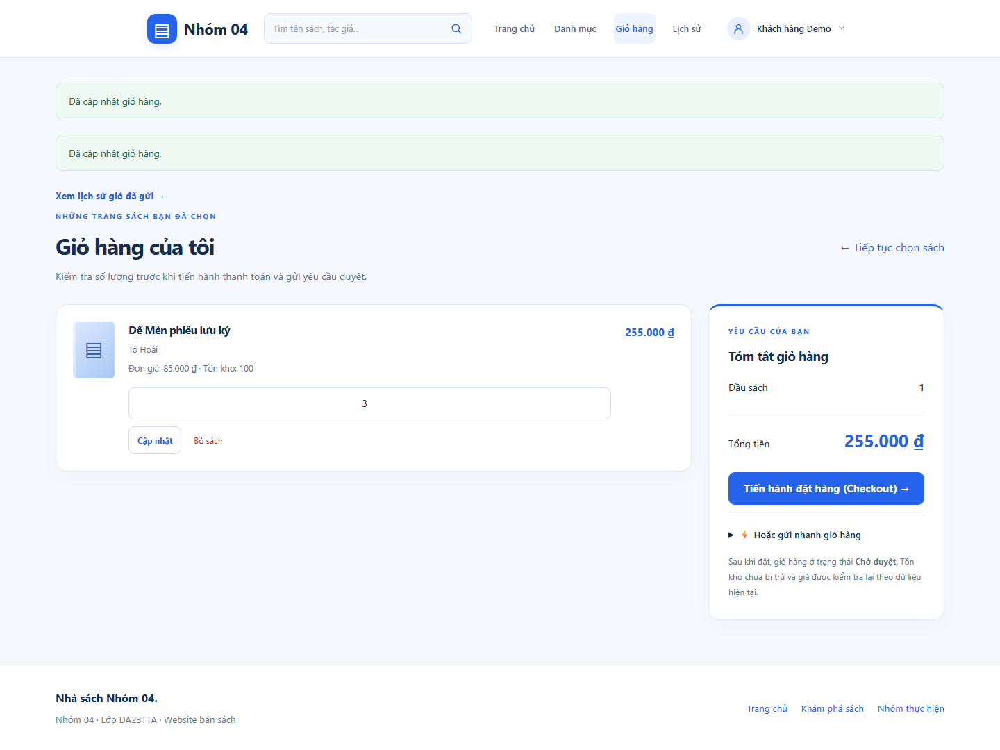
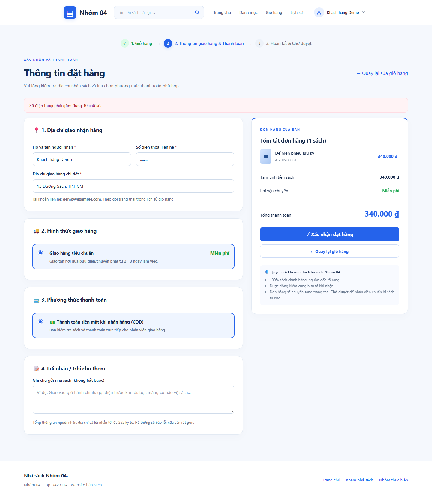

# Demo module Cart

Chạy web theo [README](../README.md#08-cài-đặt-và-chạy-dự-án), mở http://127.0.0.1:8000/. Demo trực tiếp bằng tài khoản riêng vừa đăng ký; dùng Admin đã được người vận hành cấp.

## Kịch bản thuyết trình

| Bước | Thao tác | Điều cần chỉ ra |
|---|---|---|
| 1 | Tìm sách, xem giá và kho ở danh mục | Bộ lọc/tìm kiếm/phân trang lấy SQL Server |
| 2 | Thêm cùng sách 1 rồi 2 cuốn | Một dòng lượng 3, tổng = 3 × giá server |
| 3 | Sửa thành 4, tải lại; thử bỏ sách | Session giữ giỏ, tổng cập nhật, có trạng thái rỗng |
| 4 | Vào checkout, nhập điện thoại sai | Server báo lỗi, giữ dữ liệu nhập |
| 5 | Nhập đúng và xác nhận COD | Tạo giỏ Chờ duyệt; chưa trừ kho và chưa thu tiền |
| 6 | Mở lịch sử và sửa/hủy một giỏ Chờ duyệt | Chỉ chủ giỏ thao tác, giỏ đã duyệt được bảo vệ |
| 7 | Admin duyệt giỏ khác và thử duyệt lại | Kho giảm đúng một lần; từ chối cần lý do riêng |

## Ảnh demo thực tế ngày 28/10/2026

Ảnh được chụp bằng Chrome headless từ HTML do Symfony render với SQL Server thật. Tài khoản “Khách hàng Demo” cùng thông tin nhận hàng là fixture tạm trong transaction và đã rollback. Mã giỏ trong ảnh không phải giỏ còn tồn tại để tiếp tục thao tác. Không có tài khoản/mật khẩu demo cố định được tạo sau test.

Ảnh đã được tạo lại sau migration VARCHAR(10)/điện thoại 10 chữ số; [kết quả kích thước và kiểm tra tràn ngang](evidence/2026-10-28-member-schema/screenshots.json) ghi nhận desktop 1440px và checkout 390px.

| Màn hình | Ảnh |
|---|---|
| Danh mục sách | [catalog.png](screenshots/catalog.png) |
| Thêm trùng sách, số lượng 3 | [add-to-cart.png](screenshots/add-to-cart.png) |
| Cập nhật số lượng thành 4 | [update-cart.png](screenshots/update-cart.png) |
| Checkout COD | [checkout.png](screenshots/checkout.png) |
| Điện thoại sai bị từ chối | [cart-validation.png](screenshots/cart-validation.png) |
| Chi tiết giỏ Chờ duyệt | [order-detail.png](screenshots/order-detail.png) |
| Checkout trên viewport 390px | [checkout-mobile.png](screenshots/checkout-mobile.png) |





## Tạo lại HTML làm nguồn chụp ảnh

Chỉ chạy khi không có test/phiên khác đang ghi database. Cần dữ liệu sách còn hàng và đủ bốn migration. Lệnh tạo tài khoản/giỏ tạm rồi rollback, đối chiếu fingerprint bảy bảng.

```powershell
New-Item -ItemType Directory -Path var/demo-preview -Force
$env:CART_DEMO_DIR = (Resolve-Path var/demo-preview).Path
php tests/cart_checkout_smoke.php
Remove-Item Env:CART_DEMO_DIR
```

HTML ở `var/demo-preview/` dùng `<base href="http://127.0.0.1:8000/">` để tải CSS/JS. Giữ server chạy khi mở HTML bằng trình duyệt hoặc chụp headless. Snapshot có token biểu mẫu tạm và không được commit; chỉ ảnh PNG được đưa vào tài liệu. Đây là đầu ra để xem/chụp, thao tác thật thực hiện trên website có session đăng nhập.

Không có video trong repository. Có thể ghi màn hình theo kịch bản trên khi chuẩn bị bảo vệ.
