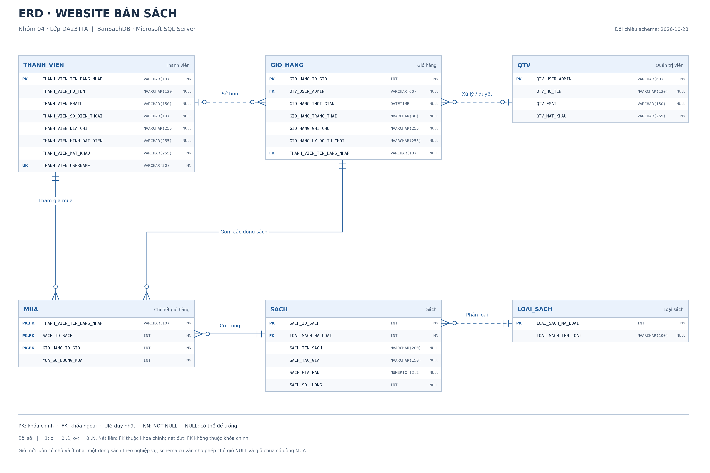
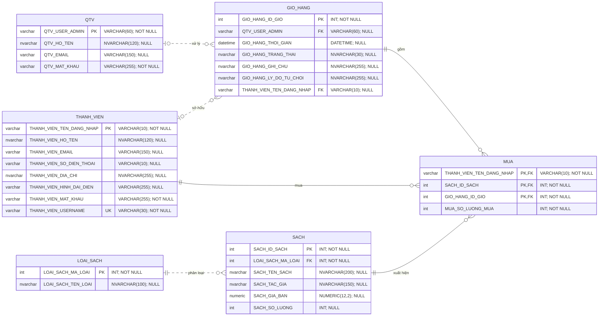

# ERD · Website bán sách

**Website bán sách – Nhóm 04, lớp DA23TTA.** Ảnh dưới đây là mô hình ERD gốc do nhóm cung cấp, gồm Sách, Loại sách, Thành viên, Giỏ hàng, QTV và quan hệ Mua.

[](database-erd-original.png)

**Ảnh gốc dùng trong báo cáo:** [Tải PNG](database-erd-original.png).

## Đối chiếu với database đang triển khai

Sơ đồ vật lý bên dưới được đối chiếu trực tiếp với metadata SQL Server của `BanSachDB` ngày 28/10/2026: 6 bảng nghiệp vụ, 31 cột và 6 khóa ngoại.



**Tải sơ đồ vật lý:** [PNG](database-erd.png) · [SVG vector](database-erd.svg) · [PDF](database-erd.pdf). [Mã Mermaid](database-erd.mmd) và [metadata đã đối chiếu](database-schema.json) được lưu cùng thư mục.

### Khác biệt giữa mô hình thiết kế và database triển khai

| Thành phần | Website đang triển khai |
|---|---|
| Quan hệ Thành viên – Giỏ hàng | Có khóa ngoại trực tiếp `GIO_HANG.THANH_VIEN_TEN_DANG_NHAP` để xác định chủ giỏ |
| Tên đăng nhập | `THANH_VIEN_TEN_DANG_NHAP` đã đổi sang VARCHAR(10); username thực tế vẫn là `THANH_VIEN_USERNAME VARCHAR(30)`, có UNIQUE |
| Điện thoại | `THANH_VIEN_SO_DIEN_THOAI VARCHAR(10)`; NULL hoặc đúng 10 chữ số theo CHECK |
| Quản trị viên – Giỏ hàng | Một giỏ có thể chưa có QTV xử lý; `QTV_USER_ADMIN` cho phép NULL |
| Chi tiết mua | `MUA` là bảng liên kết có khóa chính ghép thành viên–sách–giỏ và cột số lượng mua |
| Lý do từ chối | Có thêm `GIO_HANG_LY_DO_TU_CHOI NVARCHAR(255) NULL`, tách khỏi ghi chú khách |
| Kiểu dữ liệu | Các trường tên tiếng Việt, địa chỉ, trạng thái, ghi chú dùng NVARCHAR; thời gian giỏ dùng DATETIME |

Ảnh ban đầu dùng `VA`, `N12,2`, `D` là ký hiệu kiểu dữ liệu ở mô hình khái niệm. Khi mô tả database triển khai cần ghi đúng `VARCHAR`/`NVARCHAR`, `NUMERIC(12,2)` và `DATETIME` theo schema.

## Quan hệ và bội số

| Quan hệ | Bội số theo database | Ý nghĩa |
|---|---|---|
| `LOAI_SACH` – `SACH` | 1 – 0..N | Mỗi sách thuộc đúng một loại; một loại có thể chưa có sách |
| `THANH_VIEN` – `GIO_HANG` | 0..1 – 0..N | Chủ giỏ là FK nullable để tương thích dữ liệu cũ; giỏ mới luôn được ứng dụng gán chủ |
| `QTV` – `GIO_HANG` | 0..1 – 0..N | Giỏ chưa xử lý có thể chưa có QTV; một QTV có thể xử lý nhiều giỏ |
| `THANH_VIEN` – `MUA` | 1 – 0..N | Mỗi dòng mua liên kết đúng một thành viên |
| `SACH` – `MUA` | 1 – 0..N | Mỗi dòng mua liên kết đúng một sách |
| `GIO_HANG` – `MUA` | 1 – 0..N | Mỗi dòng thuộc đúng một giỏ; ứng dụng yêu cầu ít nhất một dòng khi gửi giỏ |

Bội số tối thiểu trong sơ đồ vật lý phản ánh ràng buộc database, không suy diễn rằng mọi thành viên phải mua hàng hoặc mọi loại sách phải có sách. Nét liền biểu diễn quan hệ định danh, FK nằm trong khóa chính của bảng con; nét đứt biểu diễn FK không thuộc khóa chính.

## Sơ đồ Mermaid có thể chỉnh sửa



`MUA` có khóa chính ghép `(THANH_VIEN_TEN_DANG_NHAP, SACH_ID_SACH, GIO_HANG_ID_GIO)`, ba cột đồng thời là khóa ngoại. Bảng chưa lưu đơn giá tại thời điểm đặt; tổng lịch sử được JOIN với giá hiện tại của `SACH`.

Không cần bổ sung bảng `CHECKOUT` vào ERD: checkout là quy trình xác nhận, lưu giỏ vào `GIO_HANG` và các dòng vào `MUA`. Giỏ nháp dùng Symfony Session nên không nằm trong ERD. `doctrine_migration_versions` là bảng hạ tầng, không tính vào sáu bảng nghiệp vụ.

## Đoạn mô tả dùng trong báo cáo

> Cơ sở dữ liệu BanSachDB gồm sáu bảng nghiệp vụ: LOAI_SACH, SACH, THANH_VIEN, QTV, GIO_HANG và MUA. Bảng GIO_HANG lưu thông tin chung và khách hàng sở hữu giỏ hàng; bảng MUA lưu sách cùng số lượng của từng giỏ. Mỗi sách thuộc một loại sách và có thể xuất hiện trong nhiều dòng mua. Một thành viên có thể sở hữu nhiều giỏ; một quản trị viên có thể xử lý nhiều giỏ. Giỏ chưa được xử lý có thể chưa liên kết quản trị viên. Các khóa chính, khóa ngoại và khóa chính ghép của MUA bảo đảm tính toàn vẹn tham chiếu giữa các bảng.

## Tạo lại sơ đồ vật lý

Chạy tại thư mục gốc dự án, với cấu hình database hiện tại. Lệnh PHP chỉ đọc metadata schema, không đọc dữ liệu tài khoản và không ghi database. Công cụ Python phục vụ xuất tài liệu, không phải dependency để chạy website.

```powershell
php scripts/export_erd.php
# Cài matplotlib nếu môi trường xuất ảnh chưa có thư viện này
python -m pip install matplotlib
python scripts/render_erd.py
```

Renderer tạo PNG, SVG, PDF, mã Mermaid và đồng bộ khối Mermaid trong tài liệu này từ `database-schema.json`. Nếu cấu trúc quan hệ thay đổi, cần kiểm tra và điều chỉnh bố cục trước khi xuất lại.

Ảnh gốc của nhóm được lưu riêng tại `database-erd-original.png`.
