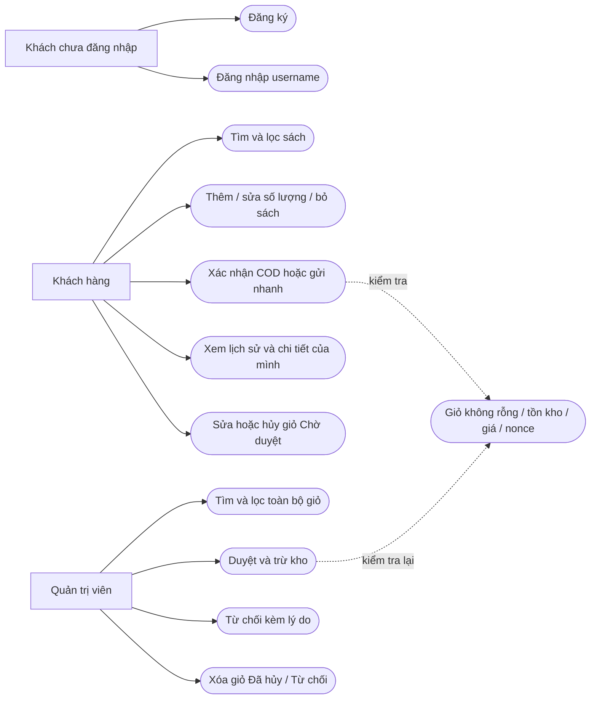

# Use case · Module giỏ hàng

[Ảnh PNG](use-case.png) · [SVG vector](use-case.svg). Tạo lại ảnh bằng `python scripts/render_cart_diagrams.py` (cần matplotlib).

Sơ đồ nhóm chức năng theo tác nhân, biểu diễn bằng Mermaid flowchart để GitHub hiển thị trực tiếp.

Chỉ tài khoản khách hàng có ROLE_USER; Admin có ROLE_ADMIN riêng. Sơ đồ không có tác nhân cổng thanh toán vì chưa tích hợp dịch vụ thu tiền online.
